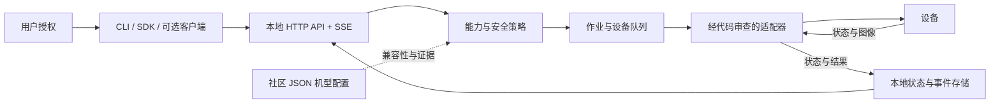

# 架构与能力边界

项目名称为 **AnyAdapter Hub（万能适配）**。核心是独立的本地设备服务：任何经过授权的客户端都可以提交动作、读取状态和接收事件。Collie 可以作为客户端，核心不依赖 Collie、特定 Agent 或 MCP。

## 服务与客户端

`device-hub.mjs` 提供初始化、服务启动、CLI 调用和授权管理。服务仅绑定本机回环地址，HTTP 请求使用 Bearer 凭据；SSE 传送经过设备范围和能力检查的事件。Node SDK 位于 `lib/hub/client.mjs`，与服务通过同一 HTTP API 通信。

设备凭据只由服务端适配器使用，不交给普通客户端。客户端授权按设备、能力、有效期划分，可以撤销。读取状态、读取事件、发起截图和读取截图分别授权。MCP 或 Collie 的接入属于客户端集成，不应假定旧 MCP 入口已经全部改为经过 Hub。

## 设备状态与动作

LG 适配器使用已知 SSAP、DLNA 和机型特定观测通道。普通控制与临时特权观测分别授权；普通应用启动不能借助参数启动特权桥接。服务提供固定动作，不暴露任意 Luna、shell 或本地文件读取入口。

当前 LG 状态来源是默认约五秒一次的非重叠轮询，不宣称已具备持续 ACB 事件订阅。每个字段保存自己的 `observedAt`、`expiresAt`、`source` 和验证范围；状态读取另计算 `stale`。连接在线不表示所有字段都新鲜，最近一次截图也不等于当前实时画面。适配器事件不包含图像字节、电视地址或配对密钥。

动作先经过能力与本地策略检查，再成为有截止时间和幂等键的作业。入队与实际派发前重新检查授权和期限。每设备队列串行处理刷新、控制和完整观测事务，避免后来的控制被观测恢复步骤覆盖。对可能已送达的写操作不自动重试；失败后只尝试读取状态进行核对。

重启时排队作业被取消，执行中的作业标为结果未知，不自动重放。任务结果区分 `confirmed`、`unconfirmed`、`failed`、`expired`、`unknown` 和 `cancelled`。确认只涵盖结果声明的范围，不能由“已确认应用前台”推导“电影已播放”。

结果区分请求应答、状态读回和画面证据。应用启动要等待真实前台 ID；音量、静音和输入切换要读回；DLNA 控制读取其 transport 状态。临时观测能读取内部播放管线和截图，但 `playing` 仍可能来自预览，不能自动推断片名。

临时观测按次生成凭据和受限回传地址，限制来源设备、路由、时长与数据量。电视端只运行固定观测流程；结束后关闭覆盖层、恢复应用并核对受控资源清理。该通道依赖特定型号的系统行为，需显式本地 opt-in，不能推广为所有 webOS 电视可用的功能。

## 图像与历史

截图与普通状态分别存储。动作结果可以给出帧 ID 和元数据；取得图片还需要该设备的 `screen.read` 授权，知道帧 ID 不等于获准读取。创建图像由 `screen.observe` 控制，并继续受设备本地观测开关约束。

当前帧有效期为五分钟，每设备最多保留五帧，总图像大小有上限；过期帧不可读取，并由周期任务清理。删除记录不等于磁盘介质安全擦除。事件日志保留最近一万条，过旧的 SSE 游标可能存在缺口，应重新读取状态。作业及幂等记录不随事件日志裁剪，目前没有自动历史归档策略。

## 机型配置是数据

配置仅描述型号、精确固件版本、已知适配器、已知能力及公开证据。运行时校验未知字段、重复键、原型污染、大小与嵌套限制。证据只接受仓库内脱敏文档引用。

兼容性判断必须精确匹配设备身份。配置不能声明新端点、脚本、命令、网络地址、凭据或权限，也不能通过填写 `verified` 自动启用功能。`temporary-observe` 必须声明 `optInRequired:true`；展示该元数据仍不等于获得运行许可。

新增适配器或特权机制必须经过独立代码审查、测试及用户授权策略审查。社区提交的配置、证据和设备画面均按不可信输入处理。

## 验证与后续接入

2026-10-19 已对单台 B8 完成本地 Hub HTTP 链路的有限真机验证，包括静音切换与恢复、幂等作业、截图回传、清理与应用恢复、授权拒绝及 SSE 事件。范围见 [本地 Hub 实测记录](LOCAL_HUB.md#live-verification)，不能外推到全部动作或其他型号。

临时 B8 观测是按次读取状态和单帧截图，不是实时视频流，也不等于取得 Linux root、Disney+ DOM 或指定片名的播放证据。

Home Assistant、Matter 及其他厂商适配器是待评估的集成方向，当前未实现。后续接入仍须经过同一能力策略层，并保留各设备的状态反馈和权限边界。更换型号配置不会自动安装驱动、运行固件利用或提升权限。

实测范围见 [B8 证据记录](evidence/lg-b8-2026-10-19.md)，风险和当前限制见 [安全说明](../SECURITY.md)。

启动命令、授权和 SDK 示例见 [本地 Hub 使用说明](LOCAL_HUB.md)。
