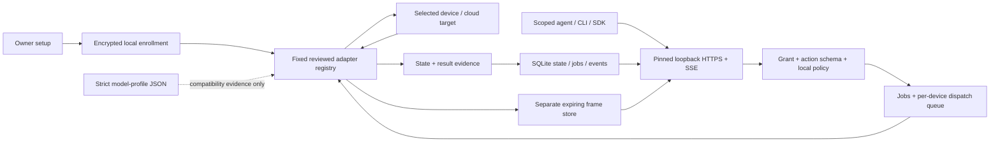

# Architecture

AnyAdapter Hub is an independent local service for authorized device control and
observation. CLI/SDK clients, agents and optional integrations use the same
capability policy. It does not depend on a particular agent, Collie or MCP.
Existing direct TV/MCP tools are separate entry points; they have not all been
converted into Hub clients.

## Components and authority

| Component | Responsibility |
| --- | --- |
| `device-hub.mjs`, `lib/hub/config.mjs` | Owner setup, encrypted enrollment references, enabled adapters and per-device features |
| `lib/hub/server.mjs`, `client.mjs` | Local HTTPS API, scoped SSE and Node client; fixed loopback binding and pinned server identity |
| `lib/hub/policy.mjs` | Exact action IDs, bounded argument schemas, grants, URL/media policies and redaction |
| `lib/hub/runtime.mjs`, `store.mjs` | Authorization, idempotent jobs, serial dispatch, snapshots, events and bounded frame storage |
| `lib/hub/adapters.mjs` | Metadata-only catalog and lazy imports of fixed reviewed implementations |
| `lib/adapters/` | Selected protocol implementation, readback, freshness, target binding and cleanup |
| `lib/security/` | Purpose-bound encrypted secrets, Hub TLS identity and LG certificate trust |
| `profiles/`, `lib/device-profile.mjs` | Exact model/firmware evidence data; no executable registration or permission grant |

The owner selects local targets and configures upstream credentials. Scoped
clients receive neither device credentials nor authority over other enrolled
devices. Their grants name exact device IDs, capabilities and expiry and can be
revoked. `state.read`, `events.read`, `app.list`, `screen.observe` and `screen.read`
are distinct authorities; knowing a frame ID does not grant access to its bytes.

Install, enable, enroll, select features and grant are separate steps. Reviewed
vendor source is included for inspection, while third-party vendor dependencies
remain optional. Startup lazily loads only enabled enrolled adapters. An empty
core can be initialized and served without loading a vendor or connecting to a
device. See [modular architecture](MODULAR_ARCHITECTURE.md).

## Adapter contract

There is no abstract adapter base class or executable plugin API. The runtime
consumes a small object contract: an explicit `supportedActions` list plus
`subscribe()`, `start()`, `execute()` and `close()`. `observe()` is required only
when the adapter advertises `screen.observe`. Both current adapters expose
`snapshot()` as an implementation utility, and LG also exposes `identity()`;
neither is a generic Hub-required method. The precise signatures and data shapes are in
[adapter requirements](ADAPTER_REQUIREMENTS.md#runtime-contract).

The Hub queues submitted operations per device. Each adapter also serializes its
own polls, controls and observation transaction through a bounded shared queue.
This prevents a polling race or a late observer restoration from overwriting
the next command. Adapters publish projected local `device.state` events;
`subscribe()` is not a claim of an upstream live telemetry subscription.

## State and freshness

A snapshot has `deviceId`, `revision`, `assembledAt`, `connection.phase` and
`fields`. Every field carries its own `value`, `observedAt`, `expiresAt`, `source`
and `verification`. Reads compute `stale` from expiry. An online connection does
not make every field fresh; receipt time and the device's actual measurement time
are different concepts.

LG normally polls about every five seconds, without overlapping work. Its
ordinary state comes from SSAP; DLNA and temporary-observer data have their own
sources. There is no general continuous ACB event stream. ECOVACS uses a cloud
worker and polls no faster than every 30 seconds. Failed reads expire affected
cached data. Clients must inspect freshness and verification scope rather than
treat the newest event or screenshot as a live view.

## Jobs, deadlines and uncertainty

Submission checks the grant, advertised action, strict arguments and local
policies before creating a job. Its client-scoped idempotency key is bound to
the canonical request: the same request returns the same operation; reusing a key
for different arguments is rejected. Persisted/public records omit sensitive
arguments. An idempotency key does not make a device transactional or undo work.

The runtime checks authorization and deadline again at execution. The adapter
must call `context.assertDispatch()` from inside its queue after asynchronous
preparation and immediately before effects, repeating the check for later writes
in a multi-step action. ECOVACS additionally waits for a worker preflight before
authorizing movement. Revocation while waiting must prevent dispatch. Once work
may have been sent, an error can leave the outcome `unknown`.

Jobs move from `queued`/`running` to `confirmed`, `unconfirmed`, `failed`,
`expired`, `unknown` or `cancelled`. Confirmation means only the result's stated
scope: foreground app, mute readback, DLNA transport state or a completed
observation. Request acceptance is insufficient; a `playing` pipeline does not
identify a movie, and robot state does not prove cleaning completion.

There is no automatic mutation retry or restart replay. At restart, queued jobs
are cancelled and interrupted running jobs become unknown. Reconciliation uses
fresh reads, not another write. A deadline cannot retract an effect already
sent; cleanup of an already started observation still needs to finish safely.

## Observation and retention

The B8 observer is a bounded, model-specific opt-in transaction. It temporarily
uses a privileged system overlay and fixed internal service calls, then closes
the overlay, restores the original app and checks owned capture cleanup. It is
not a persistent TV agent, Linux root session, continuous video stream or access
to Disney+ DOM/title internals.

The adapter returns JPEG bytes separately from sanitized metadata. The runtime
stores them in an authenticated frame store and returns a frame reference.
Current limits are a five-minute TTL, five frames per device, 10 MiB per frame
and 32 MiB retained total; periodic pruning runs every 30 seconds. State/events
never carry image bytes. Expired frames cannot be read. Record deletion does not
promise secure erasure of disk blocks or backups.

Events retain roughly the latest 10,000 records. An old SSE cursor can miss
history; clients should reread state after gaps. Jobs and idempotency records
currently have no automatic history archive/pruning policy.

## Trust and current evidence

Live credentials and the Hub TLS key are protected by Windows CurrentUser DPAPI.
macOS/Linux production secret providers are not implemented; explicit portable
test providers do not change that deployment limit. Hub clients pin the local
HTTPS identity. LG requires pinned WSS/HTTPS before sending its pairing key,
with no plaintext downgrade. Initial trust enrollment and vendor-shared
certificates have limits described in [secure setup](SECURE_SETUP.md).

The Hub, reviewed adapters, dependencies, interpreter and OS account are trusted
code. Lazy imports and a worker subprocess are not an OS sandbox. A client with
only a scoped token has narrower rights; one with owner-file access or local
code execution does not have that isolation. Profiles, evidence, device strings
and screens are untrusted data and cannot authorize actions.

The [LG](evidence/lg-b8-2026-10-19.md) and
[local Hub](evidence/local-hub-2026-10-19.md) records establish limited earlier
hardware behavior; the new LG certificate-pinned path is not yet revalidated on
that TV. [ECOVACS evidence](evidence/ecovacs-x11-2026-10-19.md) covers read-only
worker/Hub state and details, not hardware movement tests. Home Assistant,
Matter and other proposed integrations are not implemented. Consult the exact
[support matrix](SUPPORTED_DEVICES.md), [security review](SECURITY_REVIEW.md) and
[security policy](../SECURITY.md) before making wider claims.
